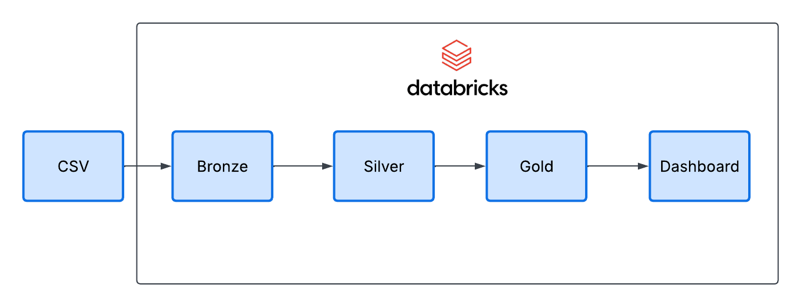

# Customer Segmentation: Case Study

## Executive Summary

This project analyzes two years of household-level retail transaction data to solve a core business problem: **How can the retailer identify its most valuable customers, understand their behaviors, and optimize marketing spend to increase retention and revenue?**

Using an end-to-end data pipeline in Databricks, I ingested over 2.6 million transaction records, engineered features, and built a dynamic RFM (Recency, Frequency, Monetary) Segmentation model. The final output is an interactive dashboard that provides actionable insights for the marketing and sales teams.

## 🎯 Business Objectives

* **Segment the Customer Base:** Move beyond basic demographics to behavioral segmentation using RFM analysis.
* **Profile Key Segments:** Understand what categories high-value customers buy and how they interact with the store.
* **Measure Marketing Impact:** Evaluate the effectiveness of direct marketing campaigns and coupon redemptions.
* **Provide Strategic Recommendations:** Suggest targeted marketing strategies for "At Risk" and "Champion" customers.

## Technology Stack

This project simulates a modern production data environment using the Medallion Architecture:

* **Cloud Platform:** Databricks (Unity Catalog)
* **Data Storage:** Delta Lake (Bronze, Silver, Gold layers)
* **Data Processing:** PySpark & Spark SQL
* **Visualization:** Databricks SQL Dashboards

## Data Pipeline (Medallion Architecture)

1. **Bronze Layer (Raw):** Ingested raw CSVs (`transaction_data`, `hh_demographic`, `campaign_table`, etc.) directly into Databricks volumes as Delta tables without transformations.
2. **Silver Layer (Cleaned & Joined):**
   * Casted data types, handled null values, and removed duplicates using PySpark.
   * Joined transaction data with product metadata and household demographics.
   * Calculated actual shelf prices accounting for coupons and loyalty discounts.
3. **Gold Layer (Business Ready):**
   * Aggregated data to the household level.
   * Engineered RFM scores using SQL `NTILE()` window functions.
   * Created final tables for Dashboarding.

## Key Insights * Findings

## Recommendations
